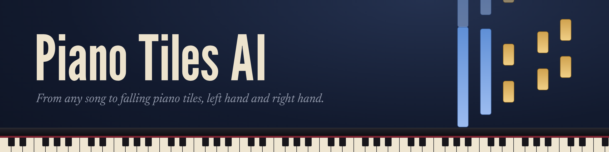
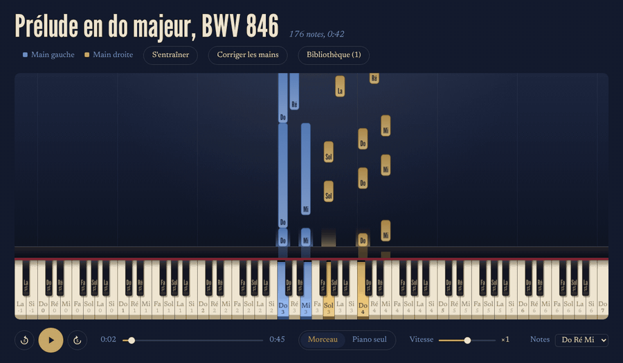
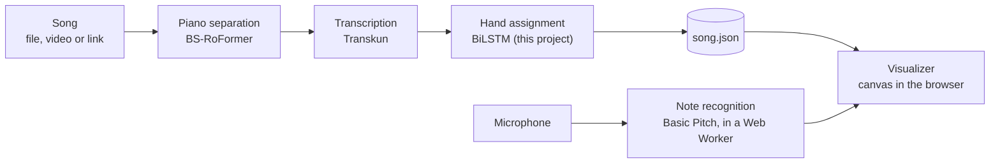

<p align="center">
  
</p>

<p align="center">
  <a href="https://github.com/yanishalloum/piano-tiles-ai/actions/workflows/tests.yml"></a>
  
  
  <a href="https://github.com/astral-sh/ruff"></a>
  <a href="LICENSE"></a>
</p>

Drop a song (an audio or video file, or a YouTube or TikTok link) and Piano Tiles AI
**isolates the piano, writes down every note, decides which hand plays it**, and shows
the result as falling tiles you can watch, correct and practise with your own piano.

<p align="center">
  
  <br>
  <sub>J. S. Bach, Prelude in C major BWV 846 (public domain). Blue: left hand. Gold: right hand.</sub>
</p>

## Features

- **Any song in**: audio files (MP3, WAV, FLAC, OGG, M4A), videos (MP4, MOV, WebM, MKV), or a link,
  added by drag and drop. Songs are processed in the background and kept in a library.
- **Piano isolation, transcription and hand assignment**, all on your own GPU.
- **A visualizer** drawn on a canvas: pause, rewind, speed from ×0.5 to ×1.5 (pitch kept),
  full mix or piano only, note names in English (C D E) or French solfège (Do Ré Mi).
- **Hand correction**: click a tile to move it to the other hand (Shift + click for the whole
  chord, Ctrl + Z to undo). Corrections are saved apart from the model's output, so they can
  later become test and training data.
- **Practice mode**: the song waits until you play the right notes on your piano, heard through
  the microphone. Practise one hand or both; skip a chord if you are stuck.

## How it works



| Step | Model | Why this one |
|---|---|---|
| Separation | [BS-RoFormer](https://arxiv.org/abs/2309.02612) via `bs-roformer-infer` | Clean piano stems where Demucs (`htdemucs_6s`) left drums and voice in. About 16 s per minute of music on a GPU. |
| Transcription | [Transkun](https://github.com/Yujia-Yan/Transkun) | Note-level piano transcription with onsets, offsets and velocities. |
| Hands | A bidirectional LSTM trained here | Reads the notes in both directions of time: who plays a note depends on what comes before *and* after. See [docs/hands.md](docs/hands.md). |
| Listening | [Basic Pitch](https://github.com/spotify/basic-pitch-ts) (Spotify) | A small polyphonic model (< 1 MB) that runs in the browser with TensorFlow.js. |

The web app is a [FastAPI](https://fastapi.tiangolo.com) server bound to `127.0.0.1`. It processes
one song at a time (one GPU), stores each song in its own folder, and serves the visualizer.
The API is documented at `/docs` while the server runs.

## Results

**Hand assignment**, on held-out pieces of [piano-midi.de](http://www.piano-midi.de) (split by a hash of the file name, so a piece never leaks between training and test):

| Method | Test accuracy |
|---|---|
| Split at middle C | 83.2 % |
| 1-D k-means over a sliding window | 90.6 % |
| Transformer encoder | 93.3 % |
| BiLSTM | 94.1 % |
| **BiLSTM + data augmentation** (transposition, tempo, velocity, dropped notes, timing jitter) | **94.5 %** |

**Would physical rules help?** Before writing a constrained decoder, I measured how many of the
model's errors break a rule no pianist can break: more than 5 notes or a span wider than a tenth in one
hand, left hand above right hand, a jump of two octaves in under 120 ms
([`scripts/physics_headroom.py`](scripts/physics_headroom.py), validation set, 26,724 notes).
Only **2.6 %** of the errors do, so these rules could add at most **0.1 point**. The remaining errors
are physically plausible; only a fingering model (Parncutt et al., 1997;
Nakamura et al., 2014) could tell them apart.

**Listening to the player.** Simulated practice sessions on a piano rendered from real samples
(72 chords, 3 to 4 notes each):

| Method | Right chords accepted | Chords a semitone off accepted |
|---|---|---|
| Harmonic summation written by hand (Klapuri, 2006) | 43 % | 12 % |
| Basic Pitch | 87.5 % | 0 % |
| **Basic Pitch, lower threshold below C3** | **97.2 %** | **0 %** |

## Getting started

Requirements: Linux or WSL 2, an NVIDIA GPU with CUDA 12.6+ (strongly recommended),
[uv](https://docs.astral.sh/uv/) and FFmpeg.

```bash
sudo apt install ffmpeg
git clone git@github.com:yanishalloum/piano-tiles-ai.git
cd piano-tiles-ai
uv sync                      # Python 3.11, PyTorch for CUDA 12.6 and every dependency
uv run piano-tiles-ai serve  # then open http://localhost:8765
```

The first song takes longer: the separation and transcription models are downloaded once.
The hand model is expected at `models/hand_lstm.pt`. It is not distributed (see [Licence](#licence)):
train it with `train_hand_model` in `hand_model.py`, as described in [docs/hands.md](docs/hands.md).

**Practice mode** needs a microphone and Chrome or Edge. Leave the song muted, or wear headphones:
otherwise the microphone hears the song instead of you.

## Development

```bash
uv run pytest -q          # 109 tests; the AI models are replaced by fakes, so no GPU is needed
uv run ruff check .       # lint
uv run ruff format .      # format
```

```
src/piano_tiles_ai/
    separation.py      piano stem (BS-RoFormer), cached by file hash
    transcription.py   notes (Transkun), cached
    hand_*.py          hand data, features, augmentation and models
    physics.py         physical rules of piano playing
    pipeline.py        song -> notes with hands
    library.py         songs on disk: upload, download, status, corrections
    server.py          FastAPI app
web/                   the visualizer (no build step)
scripts/               experiments
docs/                  design notes: separation, data, hands
```

## Limitations

- Pop songs have no ground truth for hands: the accuracy above is measured on classical MIDI files.
  The hand corrections made in the app are meant to become a pop test set.
- In practice mode, a chord played an octave too low is still accepted about half of the time.
- Sustain pedal is not transcribed yet.
- Downloading from YouTube or TikTok is for personal use; respect the platforms' terms and the
  rights of the music. Nothing downloaded or uploaded is ever committed.

## Credits

- Hand-labelled MIDI files: [piano-midi.de](http://www.piano-midi.de), by Bernd Krueger (CC BY-SA 3.0 DE). Not redistributed.
- BS-RoFormer: W.-T. Lu, J.-C. Wang, Q. Kong, Y.-N. Hung, *Music Source Separation with Band-Split RoPE Transformer*, 2023.
- Transkun: Y. Yan, Z. Duan, *Scoring Time Intervals Using Non-Hierarchical Transformer for Automatic Piano Transcription*, ISMIR 2024.
- Basic Pitch: R. M. Bittner et al., *A Lightweight Instrument-Agnostic Model for Polyphonic Note Transcription and Multipitch Estimation*, ICASSP 2022 (Apache 2.0, copied in [`web/vendor`](web/vendor)).
- TensorFlow.js (Apache 2.0), FastAPI, PyTorch, pretty_midi, yt-dlp.
- Demo sound: Salamander Grand Piano samples by Alexander Holm (CC BY 3.0).

## Licence

The code is released under the [MIT licence](LICENSE).
The trained hand model is not part of this repository; see [Licence of the model](#licence-of-the-model).

### Licence of the model

The weights are not published for now. If they are, it will be for non-commercial use only,
under a separate licence.
